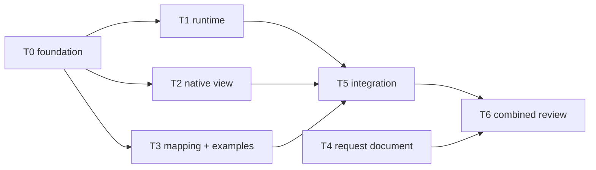

# Command-driven charts build plan

**Status:** 2026-11-20. Completed against the tree, written against `1c2b0e1`.
**Design:** [command-charts.md](command-charts.md) (accepted; no open questions). **Research:** [source research](../research/command-charts.md). **Tasks:** [task list](../tasks/command-charts.md).

Precedence: the design wins on behavior, the tree wins on fact (cosmetic drift only; say so in the commit), this file is advice and the first thing to be wrong. **Stop and report, do not commit,** when: a test is not red as predicted; a named file is dirty with someone else's work; a named symbol is gone; the fix needs a file outside the task's fence; a gate fails outside the task's scope. Do not diagnose a way through.

## Shape

One sequential **foundation** stage creates every shared type, dependency and module export. Four **independent lanes** then run in parallel on disjoint files. A sequential **integration** stage wires the application. One **combined independent review** closes the work.



No lane edits `Cargo.toml`, `Cargo.lock`, `src/lib.rs`, `src/main.rs`, `src/chart/**` or another lane's files. If a lane finds it needs one, that is a stop-and-report: the foundation owns the gap.

## Map

| Path | Owner | Change |
| :--- | :--- | :--- |
| `Cargo.toml`, `Cargo.lock` | T0 | add `jiff`, `bigdecimal`; add `examples/` to `exclude` |
| `src/lib.rs` | T0 | four `pub mod` lines; `AppConfig.chart_sources`, `AppConfig.chart_cards`; call `chart::config::validate_chart_config` in `parse_config` (~`:151-177`) |
| `src/chart/mod.rs`, `error.rs`, `decimal.rs`, `time.rs`, `config.rs`, `dataset.rs`, `reduce.rs`, `geometry.rs`, `state.rs` | T0 | new — real, tested shared types |
| `src/chart_runtime.rs`, `src/chart_view.rs`, `src/chart_mapping.rs` | T0 creates doc-comment-only shells; T1/T2/T3 replace them | see *Shell rule* |
| `tests/chart_foundation.rs`, `tests/fixtures/charts/native/*.json` | T0 | new |
| `src/process.rs` | T1 | generalize the bounded runner; `output()` keeps its behavior |
| `src/chart_runtime.rs`, `src/chart_runtime/**`, `tests/chart_runtime.rs`, `tests/fixtures/charts/runtime/*` | T1 | new |
| `src/chart_view.rs`, `src/chart_view/**`, `tests/chart_view.rs` | T2 | new |
| `src/chart_mapping.rs`, `src/chart_mapping/**`, `tests/chart_mapping.rs`, `tests/fixtures/charts/ledger/*.json`, `examples/charts/**` | T3 | new |
| `docs/requests/agent-activity-chart-source.md` | T4 | new |
| `src/main.rs`, `src/cli.rs`, `tests/cli.rs`, `config.example.toml`, `README.md`, `docs/guide.md`, `scripts/visual-test.sh`, `scripts/visual-charts.sh`, `docs/qa/charts.md`, design/plan/roadmap routing | T5 | wire, document, capture |

**Shell rule.** A shell is a file whose entire content is a `//!` comment naming its owner task and stating that it has no behavior. It exists only so `lib.rs` exports compile before a lane lands. The owning lane replaces the file wholesale and may add `src/<module>/*.rs` children. A shell exports nothing, so nothing can call fake behavior.

## Reuse before you write

- Config shape: mirror `weather::WeatherConfig` and `sensors::SensorConfig` — `#[derive(Deserialize)] #[serde(deny_unknown_fields)]`, a `validate(&self) -> Result<(), String>` called from `parse_config`, error text names the key.
- Process safety: `process::SourceProcess` (`src/process.rs:15-70`) is the only code that may kill a group before reaping the leader (PID reuse). Extend it; do not copy it.
- Process tests: `process.rs` `Fixture` (`mod tests`, pid files plus `running(pid)`) already proves descendants are stopped and reaped; reuse its shape for the runtime lane's shutdown test.
- Worker + poll: `start_local_sampling` (`main.rs:2372`) — worker thread, bounded channel, 200 ms `glib::timeout_add_local`. Integration mirrors it.
- Stale-with-retained-data: `merge_remote` (`main.rs:2413`) keeps the last success and labels "REFRESH FAILED"; the chart equivalent is `SourceSnapshot::status`.
- Theme colors: `theme::Theme`, `theme::PlotStyle::color`, `theme::css` — read-only; chart code adapts them in `ChartPalette::from_theme`.
- Visual harness: `scripts/visual-test.sh` (`SIDESCOPE_VISUAL_LIVE_STUB`, `SIDESCOPE_VISUAL_CONFIG`, `SIDESCOPE_VISUAL_SCENARIO`) and the sourced-suite shape of `scripts/visual-density.sh`.
- Integration tests write scratch under `env!("CARGO_TARGET_TMPDIR")`, never `/tmp`.

## House style that isn't obvious

- Gates always go through `./scripts/native-env.sh` (Nix in the jail, host libraries elsewhere); never bare `cargo`. `just format` before a commit; `just lint-ci` is the read-only form.
- Edition 2024 module layout: `foo.rs` beside `foo/bar.rs`; no `mod.rs` except `src/chart/mod.rs`, which is the one foundation index.
- User-visible failure text is plain, sanitized and never contains stdout, stderr or argument values (see `chart::error::sanitize_text`).
- New behavior gets permanent tests; tests lead. A bug found later needs a red reproduction first.

## Traps

- `jiff` 1.0.1 has `civil::Date::in_tz`, not `to_zoned`; the first read of its docs saves a build cycle.
- `bigdecimal` equality is numeric (`1.0 == 1.00`); render through `ChartDecimal::to_plain_string`, which normalizes, never `Display` of the inner type.
- `process::output()` treats exit-with-status as stop-and-keep-buffered-output; a chart runner must read the final buffered bytes after exit, then enforce output limit once, or large answers are truncated silently.
- Two pipes, one 20 ms poll loop: a child that fills stderr while stdout is idle deadlocks unless both are drained every pass (store only the first 8 KiB of stderr, discard the rest).
- A GTK app killed with SIGTERM skips Rust destructors, so child process groups survive. The runtime sets parent-death protection on every child; integration adds a graceful SIGTERM/SIGINT quit.
- `parse_config` is called before any window opens and its error exits 2 (`tests/cli.rs`); chart validation belongs there, not at first refresh.
- The design says commands run with the app's authority and are **not sandboxed**. Do not describe any chart command, UI text or doc as "safe", "read-only" or "sandboxed".
- `render_dashboard` compares `Vec<Card>` for widget reuse. Chart cards are not `Card`; do not widen `Card` (13 construction sites) to carry them.

## Plan-level resolutions (design is silent; cheap to revisit, listed for the review)

| # | Resolution | Reason |
| :--- | :--- | :--- |
| R1 | TOML keys are exactly those in *Frozen interfaces → Configuration*; `kind` values are `time-series`, `time-bars`, `ranked-bars` | the design's TOML is explicitly a sketch and names two kinds |
| R2 | `format = "columns-v1"` selects the generic column mapper and requires `[chart_sources.mapping]`; `sidescope-chart-v1` forbids it | one exclusive source format per source |
| R3 | Presence of a `[[chart_sources]]` entry in the owner's config is the owner's enablement; there is no `enabled` key. `sidescope doctor` prints each configured source's full command for inspection; Info shows only the executable name | design: settings expose the command; screenshots must not carry paths |
| R4 | For `sidescope-chart-v1` sources metrics and dimensions are known only from data, so a card naming an absent metric/dimension, or an unsupported `summary`, shows a card-level `CardMismatch` error while the source stays published; for `columns-v1` sources the same checks fail at configuration time | design: "absent dimensions refuse configuration" is only decidable early when a mapping declares them |
| R5 | More than 16 selected series: `interval_total` metrics rank by returned-range total and show 15 named series plus **Other**; gauges cannot be aggregated honestly, so the card shows a visible "too many series" refusal naming the count | design: top-N or small multiples, never silent disappearance |
| R6 | A card may set `bounded_percent = true` (only when the metric unit is `percent`) to draw 0–100 | design says percentages use 0–100 only when declared bounded; datasets and mappings cannot alter card config, so the declaration sits on the card |
| R7 | Default `stale_after_seconds` = `max(90, 2 × refresh_seconds)`; an explicit value below `2 × refresh_seconds` is refused | design: default 90 s, never below two intervals |
| R8 | A dataset's series must all declare the same dimension names, and no two series share a full dimension tuple | needed for `group_by` and unambiguous identity |
| R9 | `capture_stderr` (default `false`) opts one source into retaining its sanitized first 8 KiB of stderr for Info; otherwise stderr is drained and discarded | design: stderr is opt-in diagnostic content |
| R10 | Details always print the numeric UTC offset with every time, which also disambiguates repeated DST hours | design: repeated hours include offset in details |
| R11 | Decimal grammar: `-?(0|[1-9][0-9]*)(\.[0-9]+)?`; no `+`, exponent, leading/trailing dot, whitespace, `NaN`; limits 24/18 digits apply after normalization of leading zeros | design: plain notation, no exponents |
| R12 | The chart runtime starts in live mode only (`--demo`, `--report`, `--browser` never run commands) | `demo = !Live` in `main.rs`; no command may run in a mode meant for fixtures |
| R13 | Mapped numbers: decimal strings or JSON integers; JSON floats are refused | floats re-introduce rounding the design forbids |
| R14 | argv[0] beginning with `~` or containing any of `$ * ? | ; \` ` is refused at configuration time; any other argument containing `{` or `}` that is not exactly `{from}`, `{to}` or `{timezone}` is refused | design: no expansion; silent literal pass-through of `--from={from}` would be a wrong answer |
| R15 | `{from}`/`{to}` are RFC 3339 UTC with seconds and `Z`; `{to}` is the one request instant truncated to whole seconds | one captured instant |

## Frozen interfaces

Signatures are the contract; bodies, private helpers and extra private modules belong to the owning task. A signature that cannot compile as written is a stop-and-report, not a redesign.

### Foundation (`sidescope::chart`, T0 — consumed by everyone)

```rust
// chart/error.rs
#[derive(Debug, Clone, Copy, PartialEq, Eq)]
pub enum ChartErrorKind {
    ConfigInvalid, MissingExecutable, SpawnFailed, NonzeroExit, Timeout, OutputBound,
    Cancelled, ParseFailure, UnsupportedVersion, InvalidMapping, InvalidDataset, CardMismatch,
}
impl ChartErrorKind {
    pub fn suspends_retry(self) -> bool;   // true only for ConfigInvalid and MissingExecutable
    pub fn label(self) -> &'static str;    // "missing executable", "timeout", "output bound", ...
}
#[derive(Debug, Clone, PartialEq, Eq)]
pub struct ChartError { pub kind: ChartErrorKind, /* private */ }
impl ChartError {
    pub fn new(kind: ChartErrorKind, message: impl AsRef<str>) -> Self; // sanitizes
    pub fn message(&self) -> &str;
}
impl std::fmt::Display for ChartError {}
impl std::error::Error for ChartError {}
pub fn sanitize_text(text: &str, max_chars: usize) -> String; // drops control chars incl. ANSI ESC, truncates with "…"

// chart/decimal.rs
pub const MAX_INTEGER_DIGITS: usize = 24;
pub const MAX_FRACTION_DIGITS: usize = 18;
#[derive(Debug, Clone, PartialEq, Eq, PartialOrd, Ord)]
pub struct ChartDecimal(/* bigdecimal::BigDecimal */);
#[derive(Debug, Clone, Copy, PartialEq, Eq)]
pub enum DecimalError { Syntax, TooManyIntegerDigits, TooManyFractionDigits, Overflow }
impl ChartDecimal {
    pub fn parse(text: &str) -> Result<Self, DecimalError>;
    pub fn zero() -> Self;
    pub fn is_zero(&self) -> bool;
    pub fn is_negative(&self) -> bool;
    pub fn checked_add(&self, other: &Self) -> Result<Self, DecimalError>; // Overflow past 24 integer digits
    pub fn to_f64(&self) -> f64;               // drawing only
    pub fn to_plain_string(&self) -> String;   // exact, normalized, no exponent, "-0" -> "0"
    pub fn format_fixed(&self, places: u32) -> String; // half away from zero; label rounding only
}

// chart/time.rs
pub use jiff::Timestamp;
pub const MAX_FIXED_WINDOW_MINUTES: u32 = 30 * 24 * 60;
pub const MAX_CALENDAR_DAYS: u16 = 400;
pub fn parse_instant(text: &str) -> Result<Timestamp, String>; // RFC 3339 with offset or Z, fractional seconds allowed
pub fn format_utc(instant: Timestamp) -> String;               // 2026-11-20T12:00:00Z
#[derive(Debug, Clone, Copy, PartialEq, Eq)]
pub struct Interval { pub start: Timestamp, pub end: Timestamp }
impl Interval {
    pub fn new(start: Timestamp, end: Timestamp) -> Result<Self, String>; // end > start
    pub fn seconds(&self) -> i64;
}
#[derive(Debug, Clone, PartialEq, Eq)]
pub struct ChartZone { /* name + jiff TimeZone */ }
#[derive(Debug, Clone, Copy, PartialEq, Eq)]
pub struct LocalTime { pub year: i16, pub month: i8, pub day: i8, pub hour: i8, pub minute: i8, pub offset_seconds: i32 }
impl ChartZone {
    pub fn parse(name: &str) -> Result<Self, String>; // unknown IANA name refused
    pub fn name(&self) -> &str;
    pub fn local(&self, instant: Timestamp) -> LocalTime;
}
#[derive(Debug, Clone, PartialEq, Eq)]
pub enum WindowSpec { Fixed { minutes: u32 }, CalendarDays(u16) }
impl WindowSpec {
    pub fn parse_fixed(text: &str) -> Result<Self, String>; // "<n>m" | "<n>h" | "<n>d"; positive whole minutes, <= 30 days
}
/// Fixed: [now-minutes, now). Calendar: [local midnight (days-1) dates before today, now).
pub fn resolve_window(spec: &WindowSpec, zone: &ChartZone, now: Timestamp) -> Result<Interval, String>;

// chart/config.rs
pub const MIN_REFRESH_SECONDS: u64 = 5;
pub const DEFAULT_REFRESH_SECONDS: u64 = 30;
pub const DEFAULT_TIMEOUT_SECONDS: u64 = 10;
pub const STDOUT_LIMIT_BYTES: usize = 1_048_576;
pub const STDERR_LIMIT_BYTES: usize = 8_192;
pub const MAX_CONCURRENT_COMMANDS: usize = 4;
#[derive(Debug, Clone, Copy, PartialEq, Eq, Deserialize)]
pub enum SourceFormat {
    #[serde(rename = "sidescope-chart-v1")] NativeV1,
    #[serde(rename = "columns-v1")] ColumnsV1,
}
#[derive(Debug, Clone, PartialEq, Deserialize)] #[serde(deny_unknown_fields)]
pub struct ChartSourceConfig {
    pub id: String,                       // [a-z0-9][a-z0-9_-]{0,63}
    pub command: Vec<String>,
    pub format: SourceFormat,
    pub window: Option<String>,           // "3h"; exclusive with calendar_days
    pub calendar_days: Option<u16>,       // 1..=400
    pub timezone: String,
    pub refresh_seconds: Option<u64>,     // >= 5, default 30
    pub timeout_seconds: Option<u64>,     // 1..=60, default 10
    pub stale_after_seconds: Option<u64>, // >= 2 x refresh, default max(90, 2 x refresh)
    #[serde(default)] pub capture_stderr: bool,
    pub mapping: Option<MappingConfig>,   // required iff format == ColumnsV1
}
impl ChartSourceConfig {
    pub fn window_spec(&self) -> Result<WindowSpec, String>;
    pub fn zone(&self) -> Result<ChartZone, String>;
    pub fn refresh(&self) -> std::time::Duration;
    pub fn timeout(&self) -> std::time::Duration;
    pub fn stale_after(&self) -> std::time::Duration;
    pub fn executable(&self) -> &str; // command[0]
}
#[derive(Debug, Clone, Copy, PartialEq, Eq, Deserialize)]
pub enum ChartKind {
    #[serde(rename = "time-series")] TimeSeries,
    #[serde(rename = "time-bars")] TimeBars,
    #[serde(rename = "ranked-bars")] RankedBars,
}
#[derive(Debug, Clone, PartialEq, Deserialize)] #[serde(deny_unknown_fields)]
pub struct ChartCardConfig {
    pub id: String, pub source: String, pub kind: ChartKind, pub metric: String,
    pub title: Option<String>,
    pub summary: Option<Reduction>,          // default: sum for interval_total, last for gauge
    #[serde(default)] pub group_by: Vec<String>,
    pub top_n: Option<u8>,                   // ranked-bars only, 1..=16, default 5
    pub stack_by: Option<String>,            // time-bars only; must be one dimension
    #[serde(default)] pub bounded_percent: bool,
}
/// Mapping tables (pointers are RFC 6901; group- and bucket-relative as documented per field).
#[derive(Debug, Clone, PartialEq, Deserialize)] #[serde(deny_unknown_fields)]
pub struct MappingConfig {
    pub buckets: String,                     // absolute: array of interval objects
    pub interval_start: String,              // relative to one bucket
    pub interval_end: String,                // relative to one bucket
    pub groups: String,                      // absolute: array of group objects
    #[serde(default)] pub dimensions: Vec<MappingDimension>, // pointers relative to one group
    pub range_start: Option<String>, pub range_end: Option<String>,        // absolute, optional effective bounds
    pub generated_at: Option<String>, pub observed_through: Option<String>, // absolute, optional
    pub revision: Option<String>,            // absolute; string or integer
    #[serde(default)] pub notices: Vec<String>, // absolute pointers to string values
    pub metrics: Vec<MappingMetric>,
}
#[derive(Debug, Clone, PartialEq, Deserialize)] #[serde(deny_unknown_fields)]
pub struct MappingDimension { pub name: String, pub pointer: String }
#[derive(Debug, Clone, Copy, PartialEq, Eq, Default, Deserialize)]
#[serde(rename_all = "snake_case")]
pub enum OmittedPolicy { #[default] Missing, Zero }
#[derive(Debug, Clone, PartialEq, Deserialize)] #[serde(deny_unknown_fields)]
pub struct MappingMetric {
    pub id: String, pub label: String, pub unit: String,
    pub quantity: Quantity, #[serde(default)] pub estimate: bool,
    pub unknown_contribution: Option<UnknownContribution>,
    pub values: String,                      // relative to one group: array aligned with buckets
    pub quality_counter: Option<String>,     // relative to one group: aligned integers; 0 complete, >0 partial
    #[serde(default)] pub omitted: OmittedPolicy, // Zero: absent values/counter column means all zeros
}
/// Validates ids, uniqueness, command argv rules (R14), windows, bounds, mapping pointers/metric
/// declarations, card references, and (for columns-v1 sources) card metric/dimension/summary (R4).
pub fn validate_chart_config(sources: &[ChartSourceConfig], cards: &[ChartCardConfig]) -> Result<(), String>;
/// The inspectable request: computed, never executed.
#[derive(Debug, Clone, PartialEq, Eq)]
pub struct ResolvedRequest {
    pub source_id: String,
    pub argv: Vec<String>,         // placeholders substituted, one argument each
    pub window: Interval,          // requested [from, to)
    pub timezone: String,
    pub revision: u64,             // local request revision; obsolete revisions are discarded
}
pub fn resolve_request(source: &ChartSourceConfig, now: Timestamp, revision: u64) -> Result<ResolvedRequest, ChartError>;
/// Pure normalizer bound by integration; runtime tests inject a native-only one.
pub type Normalizer = fn(&ChartSourceConfig, &str, &ResolvedRequest) -> Result<dataset::ChartDataset, ChartError>;

// chart/dataset.rs
pub const MAX_INTERVALS: usize = 2_048;
pub const MAX_SERIES: usize = 256;
pub const MAX_METRICS: usize = 32;
pub const MAX_CELLS: usize = 100_000;
pub const MAX_VISIBLE_SERIES: usize = 16;
#[derive(Debug, Clone, Copy, PartialEq, Eq, Deserialize)] #[serde(rename_all = "snake_case")]
pub enum Quantity { IntervalTotal, Gauge }
#[derive(Debug, Clone, Copy, PartialEq, Eq, Deserialize)] #[serde(rename_all = "snake_case")]
pub enum UnknownContribution { Nonnegative, Unknown }
#[derive(Debug, Clone, Copy, PartialEq, Eq, PartialOrd, Ord)]
pub enum Quality { Complete, Partial, Missing }
#[derive(Debug, Clone, PartialEq, Eq)]
pub struct MetricDescriptor {
    pub id: String, pub label: String, pub unit: String,
    pub quantity: Quantity, pub estimate: bool, pub unknown_contribution: UnknownContribution,
}
#[derive(Debug, Clone, PartialEq, Eq)]
pub struct Cell { pub value: Option<ChartDecimal>, pub quality: Quality }
#[derive(Debug, Clone, PartialEq, Eq)]
pub struct Series {
    pub id: String,
    pub dimensions: std::collections::BTreeMap<String, String>,
    pub metrics: std::collections::BTreeMap<String, Vec<Cell>>,
}
pub struct DatasetParts {
    pub generated_at: Timestamp, pub observed_through: Option<Timestamp>, pub revision: Option<String>,
    pub range: Interval, pub timezone: ChartZone,
    pub intervals: Vec<Interval>, pub metrics: Vec<MetricDescriptor>, pub series: Vec<Series>,
    pub notices: Vec<String>,
}
#[derive(Debug, Clone, PartialEq, Eq)]
pub struct ChartDataset { /* private; built only through new() */ }
impl ChartDataset {
    /// Atomic validation of every design invariant (counts first, before any derived allocation),
    /// then: cells of intervals ending after request.window.end that are Complete become Partial.
    pub fn new(parts: DatasetParts, request: &ResolvedRequest) -> Result<Self, ChartError>;
    pub fn generated_at(&self) -> Timestamp;
    pub fn observed_through(&self) -> Option<Timestamp>;
    pub fn revision(&self) -> Option<&str>;
    pub fn range(&self) -> Interval;
    pub fn timezone(&self) -> &ChartZone;
    pub fn request_window(&self) -> Interval;   // retained for Info comparison
    pub fn intervals(&self) -> &[Interval];
    pub fn metrics(&self) -> &[MetricDescriptor];
    pub fn metric(&self, id: &str) -> Option<&MetricDescriptor>;
    pub fn series(&self) -> &[Series];
    pub fn dimension_names(&self) -> Vec<&str>;
    pub fn notices(&self) -> &[String];
}
/// Parses and validates `sidescope-chart-v1`; any failure refuses the whole snapshot.
pub fn parse_native_snapshot(json: &str, request: &ResolvedRequest) -> Result<ChartDataset, ChartError>;

// chart/reduce.rs
#[derive(Debug, Clone, Copy, PartialEq, Eq, Deserialize)] #[serde(rename_all = "snake_case")]
pub enum Reduction { Sum, Last }
impl Reduction { pub fn permitted(self, quantity: Quantity) -> bool; } // Sum<->IntervalTotal, Last<->Gauge
/// Sum over cells. Missing if ANY cell missing; Partial if none missing and any partial.
/// `known` is the exact sum of present values (None when no cell has a value).
#[derive(Debug, Clone, PartialEq, Eq)]
pub struct Sum { pub known: Option<ChartDecimal>, pub quality: Quality, pub missing: usize, pub partial: usize, pub cells: usize }
pub fn sum_cells<'a>(cells: impl IntoIterator<Item = &'a Cell>) -> Result<Sum, DecimalError>;
/// Last cell carrying a value; `is_latest` is false when any later cell is missing ("last known").
#[derive(Debug, Clone, PartialEq, Eq)]
pub struct LastKnown { pub index: usize, pub value: ChartDecimal, pub quality: Quality, pub is_latest: bool }
pub fn last_known(cells: &[Cell]) -> Option<LastKnown>;
#[derive(Debug, Clone, PartialEq, Eq)]
pub struct GroupedSeries { pub key: Vec<(String, String)>, pub cells: Vec<Cell> } // key order follows group_by
/// Retain only `group_by` dimensions; series sharing a retained tuple merge by per-interval sum_cells.
/// Empty group_by merges everything. Absent dimension => Err(CardMismatch). Output sorted by key.
pub fn collapse_series(dataset: &ChartDataset, metric: &str, group_by: &[String]) -> Result<Vec<GroupedSeries>, ChartError>;

// chart/geometry.rs
#[derive(Debug, Clone, Copy, PartialEq)]
pub struct TimeAxis { /* range start/end */ }
impl TimeAxis {
    pub fn new(range: Interval) -> Self;
    pub fn fraction(&self, instant: Timestamp) -> f64;            // 0..=1 by exact duration
    pub fn center(&self, interval: &Interval) -> f64;
    pub fn span(&self, interval: &Interval) -> (f64, f64);        // bar left/right; width follows real duration
}
#[derive(Debug, Clone, Copy, PartialEq)]
pub struct ValueScale { pub min: f64, pub max: f64 }
pub enum ScaleKind { Nonnegative, Signed, Percent0To100 }
/// None when there are no values. Nonnegative includes zero; Signed includes zero and both extrema;
/// outward 1-2-5 rounding; all-zero yields a nonzero span; deterministic for equal input.
pub fn value_scale(values: &[f64], kind: ScaleKind) -> Option<ValueScale>;
impl ValueScale { pub fn fraction(&self, value: f64) -> f64; pub fn ticks(&self) -> [f64; 3]; }

// chart/state.rs
#[derive(Debug, Clone, PartialEq, Eq)]
pub struct SourceInfo {
    pub executable: String,                       // name only, never a path
    pub last_attempt: Option<Timestamp>, pub last_success: Option<Timestamp>, pub next_retry: Option<Timestamp>,
    pub latency_ms: Option<u64>, pub revision: u64, pub retry_suspended: bool,
    pub request_window: Option<Interval>, pub timezone: String,
    pub stale_after_seconds: u64,
}
#[derive(Debug, Clone, PartialEq, Eq)]
pub struct SourceSnapshot {
    pub source_id: String,
    pub dataset: Option<std::sync::Arc<ChartDataset>>,  // last accepted answer, replaced whole
    pub last_error: Option<ChartError>,                 // error of the latest attempt; None after success
    pub stderr_excerpt: Option<String>,                 // only with capture_stderr
    pub info: SourceInfo,
}
#[derive(Debug, Clone, Copy, PartialEq, Eq)]
pub enum SourceStatus { Loading, Fresh, Stale, RefreshFailed { stale: bool }, Unavailable }
impl SourceSnapshot { pub fn status(&self, now: Timestamp) -> SourceStatus; }
```

Configuration shape (R1–R15), for `config.example.toml` and the tests:

```toml
[[chart_sources]]
id = "example-metrics"
command = ["example-chart-data", "--from", "{from}", "--to", "{to}", "--timezone", "{timezone}"]
format = "sidescope-chart-v1"        # or "columns-v1" with [chart_sources.mapping] + [[chart_sources.mapping.metrics]]
window = "3h"                        # or: calendar_days = 5
timezone = "UTC"
refresh_seconds = 30                 # optional, as are timeout_seconds, stale_after_seconds, capture_stderr

[[chart_cards]]
id = "recent-amount"
source = "example-metrics"
kind = "time-series"                 # | "time-bars" | "ranked-bars"
metric = "amount"
summary = "sum"                      # optional; group_by, top_n, stack_by, bounded_percent, title optional
```

### Runtime (`sidescope::chart_runtime`, T1 — no GTK/glib imports)

```rust
pub struct ChartRuntime { /* worker threads, shared state */ }
impl ChartRuntime {
    /// Spawns the scheduler thread. Does not run any command for an empty source list.
    pub fn start(sources: &[ChartSourceConfig], normalizer: Normalizer) -> ChartRuntime;
    /// Snapshots changed since the previous call, in source order (cheap Arc clones).
    pub fn poll(&self) -> Vec<SourceSnapshot>;
    /// Latest snapshot of every source, in config order.
    pub fn snapshots(&self) -> Vec<SourceSnapshot>;
    pub fn refresh_now(&self, source_id: &str);   // coalesces: at most one queued refresh per source
    pub fn retry(&self, source_id: &str);         // resumes a suspended source
    /// New config: cancel in-flight commands of changed sources, bump their revision, clear their cache.
    /// An identical source entry is untouched (no refetch). Card/presentation changes never reach the runtime.
    pub fn reconfigure(&self, sources: &[ChartSourceConfig]);
    pub fn shutdown(self);                        // stops owned process groups and reaps; Drop does the same
}
pub mod scheduler {
    pub struct Scheduler { /* private */ }
    pub enum Event {
        Tick, RefreshRequested { source: String }, RetryRequested { source: String },
        Reconfigured { sources: Vec<ChartSourceConfig> },
        Finished { source: String, revision: u64, outcome: Result<(), ChartError> },
    }
    pub enum Action { Start { source: String, revision: u64 }, Cancel { source: String, revision: u64 }, Publish { source: String } }
    impl Scheduler {
        pub fn new(sources: &[ChartSourceConfig], max_concurrent: usize) -> Scheduler;
        pub fn step(&mut self, now: std::time::Duration, event: Event) -> Vec<Action>; // monotonic time, injected
        pub fn next_wake(&self) -> Option<std::time::Duration>;
    }
}
// src/process.rs (T1 additions; output() unchanged in behavior and messages)
pub struct CancelToken(/* Arc<AtomicBool> */);
impl CancelToken { pub fn new() -> Self; pub fn cancel(&self); pub fn is_cancelled(&self) -> bool; }
impl Clone for CancelToken {}
pub struct CaptureLimits { pub stdout: usize, pub stderr: usize, pub timeout: std::time::Duration }
pub struct Captured { pub stdout: String, pub stderr: String }
pub enum RunFailure { MissingExecutable, SpawnFailed, Timeout, OutputBound, NonzeroExit(Option<i32>), NotUtf8, Cancelled }
pub fn run_bounded(command: &mut std::process::Command, limits: &CaptureLimits, cancel: &CancelToken) -> Result<Captured, RunFailure>;
```

### Native view (`sidescope::chart_view`, T2 — depends only on `chart` and `theme`; not on `chart_runtime`, `chart_mapping` or `main`)

```rust
pub struct ChartCardModel { /* pure data: header, plot, legend, details table, info, accessible name, banner */ }
/// Total: every SourceStatus and every dataset shape yields a model; never panics, never allocates
/// derived geometry beyond the dataset limits.
pub fn build_model(card: &ChartCardConfig, snapshot: &SourceSnapshot, now: Timestamp) -> ChartCardModel;
impl ChartCardModel {
    pub fn card_id(&self) -> &str;
    pub fn accessible_name(&self) -> &str;
    pub fn table_rows(&self) -> &[Vec<String>];   // exact interval, group, unrounded value, quality, unit
    pub fn info_lines(&self) -> &[String];        // source Info: last attempt/success, next retry, latency, revision, bounds
    pub fn banner(&self) -> Option<&str>;          // "Refresh failed", "Stale", "Source unavailable: <reason>", "Loading"
}
pub struct ChartPalette { /* plot, grid, text, accent and a fixed categorical ramp */ }
impl ChartPalette { pub fn from_theme(theme: &crate::theme::Theme) -> ChartPalette; }
#[derive(Debug, Clone, Copy, PartialEq, Eq)]
pub enum CardLayout { Wide, Narrow }
/// Cairo drawing is display-free so tests render to an ImageSurface.
pub fn draw_plot(cr: &gtk::cairo::Context, model: &ChartCardModel, palette: &ChartPalette, width: f64, height: f64, selected: Option<usize>);
/// Widget name `chart-card-{id}`; keyboard-focusable plot, Details/Info controls, accessible name set.
pub fn card_widget(model: &ChartCardModel, palette: &ChartPalette, layout: CardLayout) -> gtk::Widget;
/// Replace contents in place, keeping open Details and focus when `model` has the same card id; false => caller rebuilds.
pub fn update_card_widget(widget: &gtk::Widget, model: &ChartCardModel, palette: &ChartPalette) -> bool;
pub fn css(theme: &crate::theme::Theme) -> String;   // chart classes only, prefixed `chart-`
```

### Mapping (`sidescope::chart_mapping`, T3 — depends only on `chart`)

```rust
/// Pure: raw JSON + mapping + request -> dataset or structured refusal (InvalidMapping / InvalidDataset).
pub fn map_columns(raw: &serde_json::Value, mapping: &MappingConfig, request: &ResolvedRequest) -> Result<ChartDataset, ChartError>;
/// Bound by integration as the runtime's `Normalizer`: NativeV1 -> parse_native_snapshot; ColumnsV1 -> parse JSON
/// (malformed => ParseFailure) then map_columns.
pub fn normalize_output(source: &ChartSourceConfig, stdout: &str, request: &ResolvedRequest) -> Result<ChartDataset, ChartError>;
```

## Tasks

### Task 0 — foundation (sequential first)

- **Settled (design, quoted):** "Values are finite decimal strings or null … at most 24 integer and 18 fractional digits, no exponent notation; preserve decimal arithmetic through sums … Overflow refuses a snapshot." "A sum is missing if any included cell is missing, and partial if none are missing but at least one is partial." "Duplicate series/metric IDs, inconsistent lengths, unordered or overlapping intervals, and invalid timestamps reject the whole snapshot atomically. Unknown optional fields are ignored within the recognized version." "Fixed windows use positive whole-minute durations … at most 30 days … Calendar windows use a date count … (1–400), including today, starting at midnight in the named zone and ending at that same request instant." "Refresh minimum 5 seconds, timeout range 1–60 seconds … Validate before allocating derived geometry. Refuse oversized answers; never silently truncate them." Do not re-open.
- **Preconditions:** `git status --short` empty; `git rev-parse --short HEAD` is `1c2b0e1` or a descendant touching none of the Map's T0 paths; `./scripts/native-env.sh cargo test --lib` green.
- **Tests first** (`tests/chart_foundation.rs`, public API only; fixtures in `tests/fixtures/charts/native/`: `minimal.json` (the design's synthetic example), `partial-current.json`, `dst-five-days.json` (23 h and 25 h day buckets), `all-null.json`, `empty-series.json`, `gauge.json`, `many-series.json`, and one refusal file per case below):
  - decimal: accepts `0`, `-1.5`, 24+18-digit extreme; refuses `1e3`, `+1`, `.5`, `5.`, ``, ` 1`, `007`, `-`, 25 integer digits, 19 fraction digits; `0.1 + 0.2 == 0.3` exactly; 24-nines + 1 overflows; `to_plain_string` normalizes (`1.50` → `1.5`, `-0` → `0`); `format_fixed` rounds half away from zero without altering the sum.
  - time/window: `parse_instant` requires an offset; unknown zone refused; `3h` resolves to exactly `[now-3h, now)`; `0m`, `30d1m`, `90s`, `1.5h` refused; `calendar_days = 5` in `America/New_York` at `2026-11-02T20:00:00Z` starts `2026-10-29T04:00:00Z`; the 2026-11-01 day interval is 25 h and 2026-03-08 is 23 h; `calendar_days` 0 and 401 refused; `window` with `calendar_days`, or neither, refused.
  - config: the design sketch parses through `sidescope::parse_config`; an existing config without chart keys yields empty vectors; duplicate source/card ids, unknown card source, unknown keys, `refresh_seconds = 4`, `timeout_seconds = 0` and `61`, `stale_after_seconds` below twice refresh, `~/bin/x` argv[0], `--from={from}`, unknown `{when}`, `columns-v1` without mapping, native with mapping, bad pointer syntax (`buckets` not starting `/`, `~2` escape), duplicate mapping metric ids, a `columns-v1` card with an undeclared metric/dimension/forbidden summary, `top_n = 0/17`, `stack_by` on a non-`time-bars` card, `bounded_percent` on a non-percent metric (R4) are refused with messages naming the key; `resolve_request` substitutes each placeholder as one argument, formats `{from}`/`{to}` per R15, and never runs anything.
  - dataset: every fixture above; refusals — wrong `version` (`UnsupportedVersion`), duplicate series id, duplicate metric id, length mismatch, unordered/overlapping/zero-length intervals, interval outside range, `complete` with null, `missing` with a value, unknown quality, series lacking a declared metric, heterogeneous dimension names (R8), duplicate dimension tuples, control characters in labels, malformed JSON (`ParseFailure`, not empty dataset); limits at 2,049 intervals, 257 series, 33 metrics, over 100,000 cells without panic or large allocation; unknown optional fields ignored; empty series list is accepted as "no observations"; interval ending after `request.window.end` downgrades Complete to Partial and leaves Missing alone.
  - reduce: complete/partial/missing sums with subtotal; all-missing has `known == None`; overflow; `last_known` with a newer missing cell sets `is_latest = false` and carries that cell's quality; `collapse_series` with `[]`, one retained dimension and all dimensions, absent dimension (`CardMismatch`), deterministic order, quality merge across merged series.
  - geometry: `TimeAxis` bar spans proportional to real duration across the 25 h day; `value_scale` nonnegative includes zero, signed includes both extrema and zero, all-zero has nonzero span, empty is `None`, `Percent0To100` fixed, equal input gives equal output, outward rounding.
  - state/error: `status()` matrix (no data/no error = Loading; no data + error = Unavailable; data + error = RefreshFailed with `stale` per threshold; data fresh/stale); `sanitize_text` removes ESC and newlines and truncates; `ChartErrorKind::suspends_retry` true only for `ConfigInvalid` and `MissingExecutable`; no error text contains an argument value passed to `resolve_request`.
  - Red: `./scripts/native-env.sh cargo test --test chart_foundation` fails to compile with `unresolved import `sidescope::chart`` (E0432).
- **Change:** Map rows for T0. `jiff = { version = "1", default-features = false, features = ["std", "tzdb-bundle-always"] }`; `bigdecimal = { version = "0.4", default-features = false }`. Cheap and yours: file-private helper names, the order of validation, grammar via hand scanner vs regex-free parsing (no `regex` dependency).
- **Gates:** `just format && just lint-ci && ./scripts/native-env.sh cargo test --test chart_foundation && ./scripts/native-env.sh cargo test` (all existing tests green); `./scripts/native-env.sh cargo build --release` and record the stripped binary size before/after; fence gate `git diff --name-only HEAD~1 | rg -v '^(Cargo\.(toml|lock)|src/lib\.rs|src/chart/|src/chart_(runtime|view|mapping)\.rs|tests/chart_foundation\.rs|tests/fixtures/charts/native/)'` prints nothing.
- **Fences (tier 2, the fence gate):** no `src/main.rs`, `src/process.rs`, `src/cli.rs`, scripts, docs, or `src/theme.rs`. No runtime, view or mapping behavior in a shell.
- **Commit:** `feat(charts): add chart data contract, validation and shared module boundaries`.
- **Report:** the red compile error, the green test count, the release size delta, any `jiff`/`bigdecimal` API surprise, and the commit hash (recorded in the tasks file as `BASE`).

### Task 1 — bounded runtime lane (independent after T0)

- **Settled:** "Defaults: refresh every 30 seconds, timeout 10 seconds, stdout 1 MiB, stderr capture 8 KiB, stale after 90 seconds … four concurrent commands globally." "One in-flight query per source. Manual refresh coalesces to one next refresh, not a queue of clicks." "After a runtime failure, retry at 30, 60, 120, then 300 seconds, never sooner than the configured interval. Success resets the backoff. Configuration errors and missing executables suspend scheduled retry until settings change or the owner requests retry." "Configuration/window changes cancel the in-flight query and advance a local request revision; discard answers carrying an obsolete revision even if cancellation races completion." "Timeout, cancellation, output overflow, and shutdown stop the owned process group and reap the child." "Exit 0 with malformed JSON is a parse failure, not an empty dataset." "No automatic sync, collector start, migration, installation, or authentication action." Do not re-open.
- **Preconditions:** T0 landed at `BASE`; `./scripts/native-env.sh cargo test --lib process::` green before any edit.
- **Tests first:** `tests/chart_runtime.rs` drives `ChartRuntime` and `scheduler::Scheduler` with executables under `tests/fixtures/charts/runtime/` (small `sh` scripts that emit `tests/fixtures/charts/native/*.json`, hang, flood, spawn a pid-file descendant, count invocations in `CARGO_TARGET_TMPDIR`) and a native-only `Normalizer` wrapping `parse_native_snapshot`. Cases: success publishes one snapshot with dataset and `last_success`; two cards share one answer (the script's invocation counter is 1 per refresh); hung command times out in the configured timeout and its descendant is stopped and reaped; stdout over 1 MiB → `OutputBound`, nothing published; 1 MiB of stderr with valid stdout succeeds without deadlock and `stderr_excerpt` is `None`; `capture_stderr = true` keeps only the first 8 KiB, sanitized; exit 1 → `NonzeroExit` and the prior dataset stays; missing executable → `MissingExecutable`, no automatic retry until `retry()` or `reconfigure`; `Exit 0` with non-JSON → `ParseFailure`, prior dataset untouched, no partial publish; scheduler (fake monotonic time): backoff 30, 60, 120, 300, 300 never below the interval and reset by success; two `RefreshRequested` while in flight leave exactly one queued run; `Reconfigured` with a changed window cancels, bumps the revision, clears that source's cache, and a `Finished` carrying the old revision publishes nothing (race-order case both ways); unchanged source entry causes no `Start`; six sources never exceed four concurrent `Start`s; `shutdown()` and `Drop` stop and reap every running group; a SIGKILL of a test child that sets parent-death protection leaves no running descendant; error messages contain no stdout, stderr or argument values; `rg -n 'gtk|glib|adw' src/chart_runtime.rs src/chart_runtime` prints nothing. Rewrite nothing in `process.rs` tests; they must stay green unchanged. Red: `./scripts/native-env.sh cargo test --test chart_runtime` fails to compile (`ChartRuntime` not found).
- **Change:** `src/process.rs` — add `CancelToken`, `CaptureLimits`, `Captured`, `RunFailure`, `run_bounded` on the same `SourceProcess`/`waitid` loop, both pipes nonblocking and drained each pass, `ErrorKind::NotFound` → `MissingExecutable`, cancel flag checked each pass, `pre_exec` setting `PR_SET_PDEATHSIG` to `SIGKILL` (spawned only from the scheduler's long-lived thread, since the signal tracks the creating thread); `output()` becomes a call into it with the existing 1 MiB/`Stdio::null()` semantics and message strings. `src/chart_runtime.rs` + children: scheduler state machine (pure), worker pool, `ChartRuntime`. Cheap and yours: thread/channel structure, internal module split, polling granularity (advice: 20 ms like `process.rs`).
- **Gates:** `just format && just lint-ci && ./scripts/native-env.sh cargo test --test chart_runtime && ./scripts/native-env.sh cargo test --lib process::`; fence gate against `BASE`: allowed `^(src/process\.rs|src/chart_runtime\.rs|src/chart_runtime/|tests/chart_runtime\.rs|tests/fixtures/charts/runtime/)`.
- **Fences (tier 2):** no `Cargo.*`, `src/lib.rs`, `src/chart/**`, `src/main.rs`; no GTK. Do not add a clock abstraction beyond the `Scheduler`'s injected `Duration`.
- **Commit:** `feat(charts): add bounded command runtime with scheduling, backoff and cancellation`.
- **Report:** red compile error; green counts; the concurrency high-water number; the process-test run proving `output()` behavior unchanged.

### Task 2 — native view lane (independent after T0)

- **Settled:** the design's [widgets section](command-charts.md#5-widgets-and-shared-interactions) and the paragraphs after it, in particular: "For interval totals, y is amount per bucket, not cumulative spend"; "Bar width follows real interval duration; partial current day is marked 'so far'"; "Mark affected points/bars, label totals 'Known amount · incomplete'"; "'at least' is permitted only when the producer declares nonnegative unknown contributions"; "Gaps break lines; no smoothing or gap interpolation"; "select the top five on each accepted answer, with stable-ID tie-breaking; Other contains every remaining included category … keep an explicitly labeled Unknown category"; "Signed metrics rank by descending signed value and omit share percentages"; "Stacking is allowed only for nonnegative interval totals; missing components make that stack incomplete"; "A card opens a keyboard-accessible data table and source Info … Nothing depends solely on color or hover"; "Autoscale is recalculated on an accepted snapshot … never animated"; "Stable colors derive from full dimension tuples, not ranking position"; initial targets "roughly 120 px plots, three x-axis labels … at most five named legend entries" at 640 px and 378 px. Resolutions R5, R6, R10 apply. Do not re-open.
- **Preconditions:** T0 landed; `./scripts/native-env.sh cargo test --test chart_foundation` green.
- **Tests first:** `tests/chart_view.rs` builds snapshots from `tests/fixtures/charts/native/*.json` through `parse_native_snapshot` and a hand-built `SourceSnapshot`, then asserts on `build_model`/`table_rows`/`info_lines`/`banner`, and renders `draw_plot` into a `cairo::ImageSurface` (no display) to assert pixels and write PNGs. Cases: each of Loading/Fresh/Stale/RefreshFailed(with and without stale)/Unavailable banners with the prior dataset retained and labeled; headline for sum vs last, "so far" for the current day bucket, "last known" when newer cells are missing; incomplete totals read "Known amount · incomplete" and never a bare total; "at least" only with `unknown_contribution = nonnegative`; partial points and bars carry a non-color mark (assert hatch/marker pixels differ from complete with identical colors); gap breaks a line into separate segments; single point draws a mark; all-zero draws a labeled zero baseline with nonzero span; all-missing draws no baseline; ranked bars: top five by total, stable-ID tie-break, Other quality aggregated, Unknown kept separate, signed metrics ranked descending with no share percentages and bars either side of zero, share uses the known subtotal; stacking refused (card-level message) for signed or gauge metrics; 17 `interval_total` series → 15 + Other, 17 gauge series → visible refusal naming 17 (R5); colors identical for the same dimension tuple across rankings and datasets; table rows carry exact interval in the card zone with numeric offset (the 25 h DST day included), group, unrounded decimal, quality and unit; colliding shortened labels gain parent-path context while accessible names keep the full label; card-level `CardMismatch` for an absent metric/dimension and a forbidden `summary` leaves other cards on the same source unaffected; a 640 px and 378 px model have three x labels and at most five legend entries; `accessible_name` states kind, title, unit, range and freshness. PNG evidence is written only when `SIDESCOPE_CHART_CAPTURE_DIR` is set, to a directory under `target/`. Red: `./scripts/native-env.sh cargo test --test chart_view` fails to compile (`build_model` not found).
- **Change:** replace shell `src/chart_view.rs`; children cheap and yours (`model.rs`, `rank.rs`, `draw.rs`, `widget.rs`, `a11y.rs`, `style.rs`). Widget construction needs a display, so it is verified in T5; keep it thin over the tested model. Read `main.rs` (`card_view`, `history_plot`, `text`, weather Details `MenuButton`) for idioms; do not edit it.
- **Gates:** `just format && just lint-ci && ./scripts/native-env.sh cargo test --test chart_view`; run once with `SIDESCOPE_CHART_CAPTURE_DIR=target/chart-captures` and **open the PNGs** (640 px and 378 px wide: time series, daily bars with so-far and incomplete marks, ranked bars with Other/Unknown, stacked bars, failed/stale banners) — report what was inspected and what looked wrong; fence gate: allowed `^(src/chart_view\.rs|src/chart_view/|tests/chart_view\.rs)`.
- **Fences (tier 2):** no `src/theme.rs`, `src/main.rs`, `Cargo.*`, `src/lib.rs`, no import of `chart_runtime`, `chart_mapping` or `process`; no subprocess, file or network access; widgets never start work.
- **Commit:** `feat(charts): add native chart card model, drawing and accessible widgets`.
- **Report:** red compile error; green counts; PNG paths and a one-line inspection verdict per image.

### Task 3 — mapping and examples lane (independent after T0)

- **Settled:** "The mapper deliberately supports only aligned arrays, dimension renaming, decimal conversion, missing-column policy, and one quality counter per metric: zero means complete, positive means partial, absent means missing unless explicitly configured as omitted-zero. It does not contain arithmetic expressions, ledger field names, or pricing logic." "Ordered key tuples form series IDs without delimiter collisions." "Shorter arrays refuse the snapshot; explicit nulls remain missing, never padded with zeros. Matching unpriced columns determine partial cells. Without that quality mapping, a cost profile is invalid." "Default cost cards say 'Metered list-price estimate,' mapping `knownCostUSD` and `unpriced`. A separate provider-priced subscription metric maps `subscriptionKnownCostUSD` and `subscriptionUnpriced`." "Rolling queries request explicit instants … The 3h view is labeled '≈3h · 1 min' … Do not proportionally clip edge buckets." Resolution R13 applies. Do not re-open.
- **Preconditions:** T0 landed; re-read `/ctx/agent-activity/docs/reference/ledger-v1.md` (series section), `internal/ledger/wire/types.go` and `cmd/agent-activity/ledger.go` at their current commit; if the `columns` layout, `keys`, `buckets`, `range` or `unpriced` shapes differ from the [research](../research/command-charts.md#upstream-ledger-contract-bcdbf46), stop and report. Read-only: never modify `/ctx/agent-activity`.
- **Tests first:** `tests/chart_mapping.rs` through `map_columns` and `normalize_output`, with synthetic `tests/fixtures/charts/ledger/*.json` written by hand in the documented shape (no personal data; example project names `Example A`…). Cases: minute and day answers map to a valid dataset; omitted-zero cost and counter columns with `omitted = "zero"` yield complete zeros; the same absent column with the default policy yields missing; explicit `null` stays missing; shorter array refused; positive `unpriced` → partial with the known portion; subscription metric separate from metered; empty `groups` and all-null data are successful "no observations"/missing, not zero; out-of-order or overlapping buckets refused by dataset validation (`InvalidDataset`); keys `["a|b","c"]` and `["a","b|c"]` give different series ids; second answer with a corrected old bucket replaces rather than accumulates (mapper is stateless); request-end after the last bucket end marks that bucket partial; effective `range.from/to` pointers feed `range`, defaulting to first/last interval; DST five-day fixture keeps the 25 h bucket; float JSON numbers refused (R13); pointers: `~0`/`~1` decoding, missing target → `InvalidMapping` naming the mapping key but no data values, wrong type, group-relative vs absolute; `normalize_output` malformed JSON → `ParseFailure`; native format delegates unchanged; the example profile `examples/charts/agent-activity.toml` parses and validates through `sidescope::parse_config`, and every cost metric declares a `quality_counter` (a copy with it removed is refused by a test-local check that fails the profile, not by the generic mapper); an unrelated non-usage synthetic source (`examples/charts/synthetic-latency.sh`, milliseconds gauge, no ledger vocabulary) and `synthetic-spend.sh` (USD interval totals) drive `parse_native_snapshot` through the public API with identical code paths. Red: `./scripts/native-env.sh cargo test --test chart_mapping` fails to compile (`map_columns` not found).
- **Change:** replace shell `src/chart_mapping.rs` (+ `src/chart_mapping/` children, cheap and yours). `examples/charts/`: `agent-activity.toml` (opt-in, never loaded automatically; sources `recent` 3h/minute/workspace, `daily` five calendar days/day/workspace, optional `models` and `subscription`; cards timeline, daily bars stacked by project, project ranking, labeled "Metered list-price estimate"), `synthetic-spend.sh`, `synthetic-latency.sh` (both POSIX `sh`, take `--from --to --timezone`, emit `sidescope-chart-v1` for that window on stdout, deterministic), `fake-ledger.sh` (prints a `tests/fixtures/charts/ledger/` answer so the profile can run end to end with `command` swapped), `README.md` (what each file is; commands run with the app's authority, not sandboxed; replace the executable path).
- **Gates:** `just format && just lint-ci && ./scripts/native-env.sh cargo test --test chart_mapping`; each `examples/charts/*.sh` run by hand with a sample window emits JSON that `parse_native_snapshot` accepts (test covers it); fence gate: allowed `^(src/chart_mapping\.rs|src/chart_mapping/|tests/chart_mapping\.rs|tests/fixtures/charts/ledger/|examples/charts/)`.
- **Fences (tier 2):** no `Cargo.*`, `src/lib.rs`, `src/chart/**`; no agent-activity import, crate or parser anywhere in `src/` — the profile and fixtures are the only places ledger field names appear (gate: `rg -n 'knownCostUSD|unpriced|agent-activity' src/` prints nothing).
- **Commit:** `feat(charts): add generic column mapper, synthetic command examples and opt-in usage-cost profile`.
- **Report:** red compile error; green counts; the upstream commit re-read; the `rg` gate output.

### Task 4 — agent-activity request document (independent; may run beside T0)

- **Settled:** design [section 7](command-charts.md#7-suggestions-to-the-agent-activity-author): these are **proposed interface improvements**, "not required prerequisites and not requests already delivered to the other agent"; "I would not ask upstream to own chart colors, GTK layout, sparklines, or a Sidescope plugin"; a watch stream is unnecessary for the first version.
- **Preconditions:** read the `vantage-docs` skill and run `uvx vantage-check style-guide` first; read `/ctx/agent-activity` at its current HEAD (read-only; another agent is working there — never write there); record the commit read.
- **Change:** `docs/requests/agent-activity-chart-source.md` (new). One request per design section 7 row (First / Useful / Later), each with: the observed problem and its upstream locator (paths in code spans, not links), the proposed shape as a minimal JSON or flag sketch, why a generic consumer needs it, how Sidescope works today without it (wrapper/profile), an acceptance example using **synthetic** data, and what is explicitly not requested. Include the synthetic golden cases the design lists (empty, zero-only, unpriced, subscription, late correction, DST) as the first request's acceptance set. State that the document has not been delivered and that nothing here blocks Sidescope. No credentials, account data or personal transcripts.
- **Gates:** `uvx vantage-check docs/requests/agent-activity-chart-source.md` exits 0; `just format`; `git diff --check`; fence gate: only that file. Docs-only: no new software tests.
- **Fences:** no change under `/ctx`; no roadmap, design or plan edit (T5 routes links).
- **Commit:** `docs(charts): request generic chart-source surfaces from agent-activity`.
- **Report:** upstream commit read; checker output.

### Task 5 — integration (sequential after T1, T2, T3; single writer)

- **Settled:** "Existing cards/config remain unchanged when no chart sources are enabled." "The scheduler alone publishes accepted datasets; charts never start subprocesses." "Hung/noisy/malformed commands do not block GTK, survive shutdown, or publish a truncated/partial parse. Switching windows cannot publish an obsolete in-flight answer." "Keyboard details and narrow layouts remain usable; synthetic visual captures are inspected, not merely generated. No private profile or authenticated capture enters fixtures, logs, or screenshots." Resolutions R3 and R12 apply. Do not re-open.
- **Preconditions:** T1–T3 landed and their commits recorded; `just check-ci` green on the merged tree; `git diff --name-only BASE..HEAD` shows only the lanes' fences.
- **Tests first:** - `tests/cli.rs`: invalid chart config (`chart_sources` with an unknown placeholder) exits 2 before a window opens and names the key; `--help` text documents `[[chart_sources]]`/`[[chart_cards]]`; `sidescope doctor` with a configured source prints its full command and the line "commands run with this app's authority".
  - `src/main.rs` `interaction_tests`: demo/`--report`/`--browser` never construct a `ChartRuntime` (assert via the pure launch-mode predicate added next to `allow_refresh`); a chart card id never collides with a `Card` id.
  - `scripts/visual-charts.sh` (sourced suite, same shape as `visual-density.sh`, wired from `visual-test.sh`): live-stub run with `SIDESCOPE_VISUAL_CONFIG` pointing at synthetic sources (`examples/charts/synthetic-spend.sh`, `synthetic-latency.sh`, and the agent-activity profile with its command swapped to `fake-ledger.sh`) captures 640 px and 378 px; a hung-source config proves the GTK window still paints and responds to `j`; sending SIGTERM to the app leaves no process from the hung source (pid-file check); demo scenarios `charts-full`, `charts-partial`, `charts-stale`, `charts-failed`, `charts-unavailable`, `charts-dst`, `charts-many-series` build `SourceSnapshot`s from the fixtures (never live). Red: the new `tests/cli.rs` cases fail on the merged tree (`cargo test --test cli`), and the visual suite fails because the scenarios do not exist.
- **Change:** `src/main.rs` — start `ChartRuntime` in `build` beside weather (~`:722`) only in live mode with non-empty `chart_sources`, binding `chart_mapping::normalize_output`; poll it on a 200 ms `glib::timeout_add_local`; hold `Vec<(ChartCardConfig, Option<SourceSnapshot>)>` in `DashboardData` (~`:1369`); render chart cards through `chart_view::card_widget`/`update_card_widget` after the remote cards in `cards_layout` and `fit_cards_layout`, wide and narrow, preserving open Details and focus across refreshes; load `chart_view::css` in a second provider; Refresh shortcut calls `refresh_now` for every source; `app.connect_shutdown` calls `shutdown()`; `glib::unix_signal_add_local` for SIGTERM/SIGINT quits gracefully; `visual_scenario` gains the `charts-*` branches; `src/cli.rs` help schema and doctor lines; `config.example.toml` commented tables; `README.md` and `docs/guide.md` (a Charts section: owner-authored, not sandboxed, opt-in profile, labels); `scripts/visual-charts.sh`; `docs/qa/charts.md` (captures, what was inspected, limits not established); route the design `next`/`Reads with` and the roadmap row to plan/tasks/QA (see *Ships with*). The hardest judgment is fitting chart cards into screen-fit packing: cheap and yours (advice: treat each chart widget as an opaque card with measured height, as `fit_cards_layout` does for `Card` views); **stop and ask** if a chart card cannot meet 640 px and 378 px without changing existing card layouts.
- **Gates:** `just format && just check-ci && just test && just test-visual`; then inspect every generated PNG listed in `docs/qa/charts.md` directly (640 px and 378 px; Original, Paper and Terminal for the daily-bars scenario) and record what looked wrong. `git diff --name-only` stays inside the Task 5 Map row; existing 21-theme and screen-fit scenario captures are byte-compared with `scripts/compare-theme-baseline.py` where its documented use applies.
- **Fences:** no new behavior in `chart/**`, `chart_runtime`, `chart_view`, `chart_mapping`; if integration needs one, stop and report which lane's contract is wrong.
- **Commit:** `feat(charts): wire command-driven chart cards into the dashboard`.
- **Report:** red outputs; green gates; the PNG inspection list; SIGTERM/orphan check output; diff stat.

### Task 6 — combined independent review (after T4 and T5; read-only)

One reviewer reads the whole range `BASE~1..HEAD` across foundation, all three lanes, the request document and integration; it writes no source. It checks, citing paths and lines: every *Settled* quote against code; every R-resolution still sensible; every design acceptance bullet has a named test or capture; privacy (no output/argument/stderr in any error, log, Info or screenshot; no ledger vocabulary under `src/`; no personal data in fixtures); resource limits and failure cases enumerated above; fence gates re-run per task; the visual PNGs reopened and judged; docs describing the old behavior (`README.md`, `docs/guide.md`, `--help`, `config.example.toml`, `docs/design/sidebar.md` claims of "only" local/AI/weather cards); `just check-ci`, `just test`, `just test-visual`. Findings are blocker/major/minor with a path; blockers are fixed by a follow-up commit on the owning lane's files, then the affected gates and review items are re-run.

## Ships with

- Unit/integration tests are named per task above; the integration test that catches the end-to-end break is `scripts/visual-charts.sh` (real process → runtime → normalizer → model → widget in a private Sway), plus `tests/chart_runtime.rs` for the process boundary.
- Tests that must change with the behavior: `src/cli.rs` `help_text_documents_config_path_and_schema` gains chart assertions (extend, do not loosen); `tests/cli.rs` gains chart cases; `scripts/test-dev-tools.sh`, `test-deploy.sh`, `test-release.sh` stay unchanged and green.
- Docs that now describe the old thing: `README.md` (feature list, "Privacy": add that chart commands run with the app's authority), `docs/guide.md` widgets table and configuration sections, `docs/design/sidebar.md` (any statement that only AI/local/weather cards exist — check, do not assume), `config.example.toml`, `--help` schema, `docs/design/command-charts.md` header lines (`next`, *Reads with*), `roadmap.md` charts row.
- Config surface: new keys only (`chart_sources`, `chart_cards`); no default changes; no migration. `Cargo.toml` `exclude` gains `examples/`.
- Observable surface (visibility with behavior): Info shows last attempt, last success, next retry, latency, revision, request bounds and the executable name; banners distinguish refresh failed, stale, unavailable and loading; diagnostics distinguish the twelve `ChartErrorKind` labels.
- Graduation (not part of this plan): when built, a `docs/reference/charts/` system doc replaces this plan per `system-doc`; real traps move there.

## Don't

- Don't add a clock/time-mocking dependency or crate; the scheduler takes a `Duration`.
- Don't put an expression evaluator, SQL, scripting or pricing rule in the mapper; wrappers do that.
- Don't accumulate readings or persist datasets; each accepted answer replaces the previous one.
- Don't reuse `plot.rs` history slots or touch sensor/CPU plots.
- Don't make a lane compile only because another lane exists: lanes import `sidescope::chart` and `theme` only.
- Don't read, copy or fixture any real usage; synthetic names only.
- Don't push, create feature branches in the shared checkout, or bypass hooks.

## Blockers

None. Open design questions: none. The only supervisor-visible judgment calls are R5 and R6, recorded above and listed for T6.
