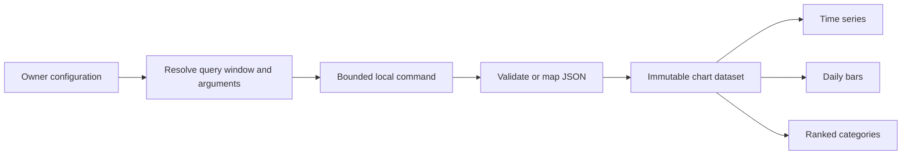

# Reusable charts driven by local commands

**Status:** 2026-11-20. Accepted; no chart-source implementation yet and no live account measurements. Grounded in Sidescope at `59d5f37` and the mounted agent-activity checkout at `bcdbf46`.

> **In short.** Teach Sidescope to plot measurements from local commands, not to understand an agent-activity database. Keep command execution, data normalization, and chart presentation separate so the same widgets can show spending, build times, traffic, or power consumption.

**Why it matters.** A compact information column should answer both “what is happening now?” and “where did the last few days go?” without a bespoke card implementation for every tool.

**The shape.** A configured command produces a versioned dataset; several native chart cards can share it, choose metrics and groups, and apply a small set of explicit reductions.

**Cost.** We own a small data contract, scheduling, chart interaction, and source diagnostics. We do not own a query language, time-series database, or vendor integration framework.

**Needs your ruling:** None. The owner approved implementation on 2026-11-20.

**Reads with:** [product design](sidebar.md), [implementation plan](command-charts-plan.md), [research](../research/command-charts.md), [roadmap](../../roadmap.md).

---

## 1. Recommendation and boundaries

My recommendation is **three chart primitives plus a shared summary header**: time series, time-bucket bars, and ranked category bars. A small-multiples layout—separate plots with shared axes—is a composition of those primitives, not another source-specific widget.

- **P1. Source-independent rendering.** Chart code receives intervals, series identities, metric values, units, and quality. It never receives session IDs, a ledger reader, provider pricing rules, or an agent-activity parser.
- **P2. History belongs to the source.** Refreshes replace queried history. Sidescope does not accumulate CLI readings into a second ledger; late arrivals and corrections can revise old buckets.
- **P3. Missing is not zero.** Only the source or an explicit mapping rule can assert that absence means zero. Estimated, partial, unavailable, and stale are different properties.
- **P4. One query can feed many views.** A five-day project dataset can supply daily totals, stacked bars, and a project ranking without three processes fetching the same answer.
- **P5. Compact is not inscrutable.** Range, bucket size, units, total meaning, and freshness remain visible. Details offer exact values and source status.

### Non-goals

No agent-activity SDK or database access; no embedded browser; no SQL editor; no arbitrary expressions inside chart config; no Python/JavaScript interpreter in the UI process; no chart plugins loaded as native code; no automatic discovery or execution of commands from a cloned repository. This does not replace the existing provider quota cards or promise that estimated usage equals an invoice.

The first implementation is **owner-authored configuration**, not a drag-and-drop dashboard builder. Generic here means reusable data and rendering boundaries, not permission to run someone else's downloaded dashboard.

## 2. What exists and what the first source offers

Verified by reading the checkouts on 2026-11-20; not by querying personal usage:

| Surface | Observation | Design consequence |
| :--- | :--- | :--- |
| Sidescope [plot geometry](../../src/plot.rs#L1-L40) | Local-history positions are tied to 120 two-second slots; weather has separate geometry | New charts need real timestamp/interval axes, not the existing fixed four-minute history arithmetic |
| Sidescope [subprocess boundary](../../src/process.rs#L1-L125) | No shell expansion; isolated process group, timeout, 1 MiB stdout limit, and cleanup; stderr currently discarded | Preserve the bounded execution approach, add useful but private source diagnostics |
| Sidescope [settings example](../../config.example.toml) | Preferences already live outside the repository; sources such as weather are opt-in | No automatic source activation or migration of existing cards |
| agent-activity series CLI | `ledger series --format json --layout columns`; minute, 5-minute, 15-minute, hour, day buckets | Already sufficient for the requested two-/three-hour and three-/five-day views |
| Grouping | Up to three of workspace, model, role, harness, channel; exact workspace filter | “Project” can initially be a display alias for workspace, not an inferred identity |
| Limits | 400 buckets; 60,000 group × bucket values; oversized queries refuse | Three hours at minute resolution fit; a week at minute resolution does not |
| Compact values | Decimal USD strings; omitted all-zero columns; explicit unpriced counts | Mapping must opt into zero omission and propagate incomplete pricing |
| Time behavior | Half-open intervals, UTC boundaries, calendar days in an IANA zone; requested ends align outward | Show returned boundaries; never silently pretend an aligned aggregate is an exact clipped rolling window |
| Quality | `generation`, `generatedAt`, `coverage`, `listEstimate`; plain subscriptions separate from metered cost | A fresh command exit does not establish complete collection or actual billed dollars |

Upstream evidence is the mounted checkout's CLI, wire types, and published contract. These locators are outside this repository and intentionally not Markdown links:

```text
/ctx/agent-activity/cmd/agent-activity/ledger.go:137-199
/ctx/agent-activity/internal/ledger/wire/types.go:48-124
/ctx/agent-activity/docs/reference/ledger-v1.md:464-628
```

A read-only mount exposes the repository, **not** the host's profile, ledger, executable environment, or credentials. No claim of a working live integration follows from reading these files.

## 3. Data model before transport

**Chart dataset** *(coined here)* means one immutable, bounded answer containing shared time intervals and dimensioned numeric series. It is not a transcript, database, or incremental append stream. The proposed external JSON version is `sidescope-chart-v1`.

A **metric** is a named numeric measurement with a unit and a permitted time reduction. A **series** is that measurement for a stable tuple of dimension values, such as project and model; its identity is not its shortened display label. These are ordinary data-analysis meanings, specified here to remove ambiguity.

### Snapshot contract

| Field | Rule |
| :--- | :--- |
| `version` | Exactly `sidescope-chart-v1`; unknown version refuses the snapshot |
| `generated_at` | RFC 3339 instant when the answer was assembled; does not mean the underlying collector is current |
| `observed_through` | Nullable RFC 3339 instant through which the producer asserts collection; null means unknown, not current |
| `revision` | Optional opaque source revision; useful for diagnostics, not a clock or a global ordering key |
| `range` | Returned `start`, `end`, and display `timezone`; exact UTC instants, start inclusive and end exclusive |
| `intervals` | Ordered non-overlapping `{start,end}` intervals inside the range; gaps allowed; each has positive duration |
| `metrics` | Unique metric IDs with `label`, `unit`, `quantity`, and `estimate`; quantity is `interval_total` or `gauge`; estimate is a boolean; optional `unknown_contribution` is `nonnegative` or `unknown` (default `unknown`) |
| `series` | Unique IDs, stable string-valued `dimensions`, and a `metrics` map containing every declared metric; metric entries contain aligned `values` and `quality` arrays |
| `notices` | Optional plain-text source caveats, visible in Info; no markup, executable content, or secret-bearing diagnostics |

`interval_total` means a quantity accrued within an interval, such as dollars spent or requests counted. Its supported time reduction is sum. `gauge` means a measurement associated with that interval, such as temperature or queue depth; its supported headline reduction is the last available observation, not sum. Unsupported reductions are configuration errors. Ratios and percentiles must come precomputed by the source; do not average p95 latency or sum percentages.

Values are finite **decimal strings or null**. Accept signed plain decimal notation with at most 24 integer and 18 fractional digits, no exponent notation; preserve decimal arithmetic through sums and only convert to floating-point for drawing. Overflow refuses a snapshot. Format rounding affects labels, not accumulated totals. Unit codes distinguish USD, EUR, bytes, seconds, percent, and producer-defined units; incompatible units never share an axis or sum. Currency conversion is outside the chart system.

Per-cell `quality` is `complete`, `partial`, or `missing`: complete requires a value, partial requires the known portion of a value, and missing requires null. “Complete” describes the producer's available measurement, **not universal source coverage**. `estimate` is independent: a fully priced list-price estimate can still be estimated. Empty series is a successful “No observations” answer, not a zero total. One point draws a mark/bar rather than a fabricated trend. Duplicate series/metric IDs, inconsistent lengths, unordered or overlapping intervals, and invalid timestamps reject the whole snapshot atomically. Unknown optional fields are ignored within the recognized version; missing required fields refuse.

### Synthetic example

```json
{
  "version": "sidescope-chart-v1",
  "generated_at": "2026-11-20T12:02:10Z",
  "observed_through": null,
  "revision": "sample-7",
  "range": {"start": "2026-11-20T12:00:00Z", "end": "2026-11-20T12:02:00Z", "timezone": "UTC"},
  "intervals": [
    {"start": "2026-11-20T12:00:00Z", "end": "2026-11-20T12:01:00Z"},
    {"start": "2026-11-20T12:01:00Z", "end": "2026-11-20T12:02:00Z"}
  ],
  "metrics": {"amount": {"label": "Estimated amount", "unit": "USD", "quantity": "interval_total", "estimate": true}},
  "series": [{
    "id": "sample-project",
    "dimensions": {"project": "Example"},
    "metrics": {"amount": {"values": ["0.12", "0.03"], "quality": ["complete", "partial"]}}
  }],
  "notices": ["Synthetic example; the second interval has an unknown remainder."]
}
```

## 4. Commands and normalization



The UI computes an inspectable request—source ID, resolved arguments, requested time bounds, timezone, and configuration revision—without executing it. The runner performs the effect outside GTK's event loop. Normalization is pure: raw JSON plus mapping plus request becomes a dataset or a structured refusal. The scheduler alone publishes accepted datasets; charts never start subprocesses.

### Two ways to attach a CLI

1. **Native contract.** Any executable or owner-written wrapper emits the snapshot above on stdout. The source can query SQLite, call a service, or invoke another CLI; Sidescope does not need to know how.
2. **Declarative column mapping.** For an existing interval/column JSON CLI, a source config names JSON pointers to interval boundaries, group arrays, dimension keys, metric arrays, and optional metadata. [JSON Pointer](https://www.rfc-editor.org/rfc/rfc6901) is an exact field selector, not a programming language. Pointers within a group are relative to that group. Ordered key tuples form series IDs without delimiter collisions.

The mapper deliberately supports only aligned arrays, dimension renaming, decimal conversion, missing-column policy, and one quality counter per metric: zero means complete, positive means partial, absent means missing unless explicitly configured as omitted-zero. It does not contain arithmetic expressions, ledger field names, or pricing logic. Arbitrary joins, cross-column computations, and source-specific coverage interpretation belong in an external wrapper. Every mapped metric declares its unit and quantity.

For agent-activity, a mapping selects `buckets`, `groups`, their `keys`, and the configured cost column. The profile explicitly declares **omitted columns are zero** because that is this CLI's documented rule; shorter arrays refuse the snapshot; explicit nulls remain missing, never padded with zeros. Matching unpriced columns determine partial cells. Without that quality mapping, a cost profile is invalid. The source's coverage caveats remain visible even when every plotted cost cell is complete.

### Configuration sketch

This is proposed syntax, **not accepted by today's application**. This direct-contract example assumes an owner-provided wrapper, not an executable shipped today:

```toml
[[chart_sources]]
id = "example-metrics"
command = ["/home/user/.local/bin/example-chart-data", "--from", "{from}", "--to", "{to}", "--timezone", "{timezone}"]
format = "sidescope-chart-v1"
window = "3h"
timezone = "UTC"
refresh_seconds = 30

[[chart_cards]]
id = "recent-amount"
source = "example-metrics"
kind = "time-series"
metric = "amount"
title = "Recent amount"
summary = "sum"

[[chart_cards]]
id = "amount-by-project"
source = "example-metrics"
kind = "ranked-bars"
metric = "amount"
group_by = ["project"]
summary = "sum"
top_n = 5
```

Source IDs and card IDs are unique and stable. A card requires source, kind, and metric; title defaults to the metric label, summary defaults to its quantity's permitted reduction, and `group_by` defaults to an empty list (reduce all source dimensions). Named grouping retains only those dimensions and reduces the others; absent dimensions refuse configuration. Commands, mappings, and datasets cannot alter card configuration.

A source requires an explicit window and timezone. Fixed windows use positive whole-minute durations such as `2h` or `3h`, at most 30 days, relative to one captured request instant. Calendar windows use a date count such as `calendar_days = 5` (1–400), including today, starting at midnight in the named zone and ending at that same request instant. These forms are mutually exclusive; unknown zones refuse configuration. Bucket selection remains a literal CLI argument, not inferred by the chart. Returned bounds govern drawing/totals; Info retains the request bounds for comparison.

Only whole-argument placeholders `{from}`, `{to}`, and `{timezone}` are supported; each becomes one argument, never shell code. Unknown placeholders refuse configuration. The executable is a literal path or PATH name; no tilde, variable, glob, command substitution, or pipeline expansion. More complicated execution requires an explicit wrapper executable. Commands run with the app's authority and inherited environment, **not in a security sandbox**; a “read-only query” label cannot guarantee a command is harmless. Settings expose the command for inspection and require the owner to enable the source; a dataset cannot supply a command.

### Scheduling, bounds, and failures

- Defaults: refresh every **30 seconds**, timeout **10 seconds**, stdout **1 MiB**, stderr capture **8 KiB**, stale after **90 seconds** without a successful read. Refresh minimum **5 seconds**, timeout range **1–60 seconds**, stale threshold configurable but never less than two refresh intervals.
- Limits: **2,048 intervals**, **256 source series**, **32 metrics**, **100,000 scalar cells**, **16 visible series** per plot, **four concurrent commands** globally. Validate before allocating derived geometry. Refuse oversized answers; never silently truncate them. The stricter source CLI limits still apply.
- One in-flight query per source. Manual refresh coalesces to one next refresh, not a queue of clicks. Identical resolved sources feed every attached card from one accepted answer. Distinct windows are distinct sources; different source snapshots are not claimed transactionally consistent.
- Refresh replaces the entire answer including historical buckets; retain one last-success answer in memory. Configuration/window changes cancel the in-flight query and advance a local request revision; discard answers carrying an obsolete revision even if cancellation races completion. They also invalidate that source's cached answer; never show old-window values under new labels. Changing card presentation alone does not refetch.
- After a runtime failure, retry at **30, 60, 120, then 300 seconds**, never sooner than the configured interval. Success resets the backoff. Configuration errors and missing executables suspend scheduled retry until settings change or the owner requests retry. No automatic sync, collector start, migration, installation, or authentication action.
- Timeout, cancellation, output overflow, and shutdown stop the owned process group and reap the child. A descendant escaping the group is outside this boundary; no sandbox guarantee is implied.
- Failure keeps prior data labeled **refresh failed** immediately, and **stale** after its freshness threshold. With no prior success, show source unavailable plus a reason. Exit 0 with malformed JSON is a parse failure, not an empty dataset.
- Diagnostics distinguish missing executable, nonzero exit, timeout, output bound, unsupported version, invalid mapping, and invalid dataset. Info shows last attempt, last success, next retry, latency, and revision. Do not log output or arguments by default; stderr is opt-in diagnostic content, never automatically copied into screenshots or persistent logs. Sanitized error text is plain text.

## 5. Widgets and shared interactions

| Primitive | Default presentation | Honest meaning |
| :--- | :--- | :--- |
| Time series | Compact unsmoothed line, optional restrained fill, range label, headline total/latest | For interval totals, y is amount **per bucket**, not cumulative spend or a derivative; step/point placement uses the interval center; Info shows boundaries |
| Time-bucket bars | Vertical bars; optional stacking by one dimension; day labels | Bar width follows real interval duration; partial current day is marked “so far”; DST days retain actual UTC duration |
| Ranked category bars | Horizontal bars, values and share of known subtotal; full labels in details | Sum over the returned range for additive quantities; default five categories plus Other |
| Summary header | Primary value, unit, estimate/partial badges, trend only if comparison supplied | `sum` for interval totals, `last` for gauges; no fabricated previous-period comparison |

Use a shared y-axis for comparable small multiples. Nonnegative data include zero; signed data include zero and both extrema; percentages use 0–100 only when declared bounded. Autoscale is recalculated on an accepted snapshot with outward rounding, never animated between data points. All-zero data show a labeled zero baseline with a nonzero drawing span; all-missing data show no baseline implying observations. Logarithmic axes are deferred. Stable colors derive from full dimension tuples, not ranking position.

**Partial is visible without color.** Mark affected points/bars, label totals “Known amount · incomplete,” and explain the unknown remainder in details. A lower-bound phrase such as “at least” is permitted only when the producer declares nonnegative unknown contributions; otherwise say incomplete. A sum is missing if any included cell is missing, and partial if none are missing but at least one is partial. A gauge's last-available value carries that cell's quality and actual observation interval; if newer cells are missing, label it “last known,” not current. Incomplete sums may show their known subtotal, never a complete-looking total. Gaps break lines; no smoothing or gap interpolation. Separate series may sum only when metric/unit/quantity match and configuration explicitly selects that grouping.

For ranked bars, select the top five on each accepted answer, with stable-ID tie-breaking; Other contains every remaining included category. Other's quality aggregates the same way as named bars. Never collapse source-unknown categories into Other: keep an explicitly labeled Unknown category. Details preserve the full ranking and explain that shares use known amounts, not unknown spend. Signed metrics rank by descending signed value and omit share percentages; signed bars extend either side of zero. Stacking is allowed only for nonnegative interval totals; missing components make that stack incomplete. More than 16 selected series requires top-N aggregation or small multiples, never silent disappearance.

A card opens a keyboard-accessible data table and source Info. Pointer hover and keyboard selection show exact interval, group, unrounded value, quality, and unit. Long labels wrap/ellipsize visually but keep their full accessible names; colliding shortened project names gain parent-path context. Time labels use the configured zone; repeated DST hours include offset in details. Nothing depends solely on color or hover.

Cards follow the existing 640 px column and density settings. Primary timeline and daily breakdown span the column; ranking/model comparisons can sit side-by-side when readable and stack at narrow widths. Start with roughly **120 px plots**, **three x-axis labels** on a compact timeline, and at most **five named legend entries** before details. These are initial visual targets requiring real captures at 640 px and the 378 px stress width, not measured layout guarantees.

## 6. First dashboard: usage costs, through generic profiles

The shipped example belongs in opt-in source/card configuration and synthetic fixtures. Neither the executable name nor these metric names appear in the chart renderer. Project, model, role, harness, and billing channel are just dimensions.

| View | Query and display | Question answered |
| :--- | :--- | :--- |
| Recent spending | Last **3h**, **minute** buckets; optional 2h preset; all projects reduced into a sparkline, one refresh per 30s | When did spending spike? Header is amount across the returned window; tooltip is USD in that minute, not USD/hour |
| Daily spending | **Five calendar dates including today**, day buckets in the configured zone; 3-day preset; totals plus optional project stacks | How much on each day? Today is “so far,” not a completed day |
| Project ranking | Same five-day dataset, grouped by workspace; top five plus Other and full list | Which projects account for the known amount? |
| Project detail | Selected workspace, three-hour timeline plus daily bars; selection changes an explicit source query | Was this project expensive today or across the week? |
| Model / role / harness | Reuse available dimensions or select an independently configured query; stacked bars or small multiples | Which model or worker category accounts for the usage? |
| Subscription activity | Separate configured token/count metric and, where applicable, provider-priced estimate | Which activity is not part of the metered estimate? |

### Compact column sketch

All numbers below are **synthetic**, not account observations. The compact sparkline and daily bars are different views, not one chart stretched to cover incompatible resolutions.

```text
METERED ESTIMATE                     Known $12.40 · incomplete
≈3h · 1 min                         Updated 10s ago · estimate
▁▁▂▁▃▆▂▁▁▂▇▃▂▁▁▅▃▂▁▂              [Details] [Refresh]

LAST 5 DATES                        Metered estimate · USD
     ▂       ▄       ▇       ▃       ▅
    Mon     Tue     Wed     Thu     Fri*
                                   * so far

BY PROJECT                          Known subtotal · last 5 dates
Example A   ████████████             $18.20
Example B   ███████                   $10.60
Example C   ███                        $4.10
Other       ██                         $2.40
[All projects]                      Collection coverage is limited
```

The recent query can group by workspace alone for metered cost, or workspace/channel for channel-specific views. Five-day project/model analysis fits the three-dimension allowance. Large group counts can still hit upstream limits; display the refusal and offer a coarser bucket or narrower filter rather than automatically changing the question.

**Labels must name what is being counted.** Default cost cards say “Metered list-price estimate,” mapping `knownCostUSD` and `unpriced`. A separate provider-priced subscription metric maps `subscriptionKnownCostUSD` and `subscriptionUnpriced`. Plain subscription token usage has no per-response dollar figure. An owner-written wrapper may explicitly combine metered and Copilot estimates into “Estimated variable spend,” with the components identified; never label that an invoice or the total cost of all subscriptions. Fixed fees, discounts, taxes, and unobserved activity are not manufactured.

Rolling queries request explicit instants. The current CLI aligns ends outward, so the 3h view is labeled **“≈3h · 1 min”**, with returned boundaries in Info; its total is for those returned buckets. Do not proportionally clip edge buckets. Calendar presets start at local midnight four/two dates before today and end now; the returned current-day bucket is provisional. Generic normalization marks intervals ending after request time partial; a source may additionally mark older buckets provisional. A stopped collector is not detectable from `generatedAt` alone: show collection freshness as unknown if the source cannot assert it.

## 7. Suggestions to the agent-activity author

These are **proposed interface improvements**, not required prerequisites and not requests already delivered to the other agent. Current columns can support the first dashboard through a profile/wrapper.

| Priority | Suggestion | Why |
| :--- | :--- | :--- |
| First | Document a stable version/capability surface for series layouts, dimension names, limits, omitted-zero columns, and decimal semantics | A dashboard should detect incompatibility rather than parse help text |
| First | Preserve requested bounds alongside effective aligned bounds; mark open/provisional buckets explicitly | Removes ambiguity around exact rolling totals and today's bar |
| First | Report collection freshness separately from answer generation, with unknown explicitly allowed | A read-only query can succeed while the collector has stopped; unchanged generation alone is not a failure |
| First | Add synthetic golden responses for empty, zero-only, unpriced, subscription, late correction, and DST cases | Consumer compatibility tests without personal transcripts or account captures |
| Useful | Allow explicit no-group/total output, and direct model/channel/harness/role filters | Avoid sending every group for one total or one selected facet; empty group currently means the default model grouping |
| Useful | Expose additive metric descriptors: units, list-estimate status, matching unpriced column, applicable billing channel | Makes generic mapping safer without making the CLI emit a Sidescope-specific format |
| Useful | Optional batch queries with one generation and shared snapshot; selective columns for large grouped responses | Coherent linked views and smaller answers; do not add until measured polling cost warrants it |
| Later | Stable project identity plus display label, separate from workspace path | Worktrees/renamed directories can represent one project, but merging them is an upstream policy decision |

I would **not** ask upstream to own chart colors, GTK layout, sparklines, or a Sidescope plugin. Those couple a reusable query tool to one display. A watch stream is also unnecessary for the first version: bounded snapshot polling makes corrections and failure recovery straightforward.

## 8. Trade-offs, delivery shape, and proof

| Alternative | Verdict |
| :--- | :--- |
| Dedicated agent-activity Rust card/parser in the app | Rejected: duplicates query semantics and makes every future tool another built-in integration |
| Accept arbitrary JSON and evaluate expressions in config | Rejected: becomes a transformation language with opaque failure and security behavior |
| Require every producer to change its CLI | Rejected: direct contract plus generic mapping/wrappers permits existing tools unchanged |
| Render prebuilt images from commands | Deferred: useful escape hatch, but loses shared accessibility, units, selection, and consistent styling |
| Persistent local history store or always-on helper | Rejected for this slice: the source already owns historical truth |

The cost is a deliberately limited mapping format and a real chart renderer. Complicated sources need wrappers; owner commands have ordinary process authority; source snapshots are independent unless the producer supplies a batch. Those are explicit trade-offs, not accidental promises of a general analytics platform.

I would build a synthetic direct-contract timeline first, then daily and ranked views from one dataset, then the generic column mapping and opt-in ledger example. Existing cards/config remain unchanged when no chart sources are enabled. No persistent data migration is needed; settings additions are additive. A source change clears only that source's memory state. A settings editor, watch transport, richer transforms, and comparisons can follow demonstrated needs rather than block the initial charts.

**Observable acceptance:**

- One synthetic command and one unrelated non-usage source drive the same widgets without renderer changes; no agent-activity dependency is needed to build or run them.
- A minute timeline covers two/three hours on first load, and the same five-day source powers daily totals and project ranking with one subprocess per refresh.
- An old-bucket correction replaces the earlier value; missing data, partial pricing, estimated values, unknown collection age, and refresh failure remain visibly distinct.
- Five calendar days around DST show five day buckets; today's bar says “so far”; displayed totals match exact decimal sums over returned buckets, including Other.
- Hung/noisy/malformed commands do not block GTK, survive shutdown, or publish a truncated/partial parse. Switching windows cannot publish an obsolete in-flight answer.
- Keyboard details and narrow layouts remain usable; synthetic visual captures are inspected, not merely generated. No private profile or authenticated capture enters fixtures, logs, or screenshots.

**Open Questions:** None filed. The design is accepted; the [implementation plan](command-charts-plan.md) is the build hand-off.

## Decision Ledger

| ID | Ruling / Decision | Date | Settled in | Built |
| :--- | :--- | :--- | :--- | :--- |
| D-CC1 | Owner approved the generic command-driven chart design and requested parallel implementation. | 2026-11-20 | [Recommendation and boundaries](#1-recommendation-and-boundaries) | — |
