# Command charts: orientation

**Status:** Verified 2026-11-20 against `232aaec` plus the commit that adds the authoring-tools page. MEASURED: the full test suites and a private-compositor run on synthetic commands and fixtures. UNMEASURED: behavior with the owner's real collector on a real desktop, and the text a screen reader speaks. See [what is not established](#what-is-not-established).

Sidescope draws time series, time bars, and ranked bars from the JSON that a local command prints. It does not understand any particular tool: spending, latency, traffic, or power are all just named numeric metrics with a unit. The subsystem is opt-in. With no `[[chart_sources]]` table in the owner's configuration, no thread, no section, and no stylesheet exists.

## Vocabulary

- **Source** — one configured command (an argument list, never a shell string) plus how to read its answer and which time window to ask for.
- **Card** — one chart, configured separately from its source, that picks a metric from a source's answer. Several cards can share one source and one answer.
- **Chart dataset** — one immutable, bounded, validated answer: shared time intervals plus dimensioned numeric series. Not a transcript, a database, or an append stream.
- **Metric** — a named measurement with a unit and a quantity, either `interval_total` (accrued within an interval, reduced by sum) or `gauge` (a reading, reduced by last observation). **Series** — one metric for one stable tuple of dimension values; identity is the tuple, never the shortened label.
- **Snapshot** — what the runtime publishes for a source: the last accepted dataset, the latest error, and timing information. Not a dataset; it carries freshness.

## Principles

These outlive any implementation.

- **P1. Source-independent rendering.** Chart code receives intervals, series identities, values, units, and quality. It never receives session IDs, a ledger reader, a pricing rule, or a tool-specific parser. Vendor field names appear only in an example profile and its synthetic fixtures.
- **P2. History belongs to the source.** A refresh replaces the whole answer, including old buckets. Sidescope never accumulates readings into a second ledger, so late corrections revise the past.
- **P3. Missing is not zero.** Only the source, or an explicit mapping rule, can say that absence means zero. Estimated, partial, missing, stale, and unavailable are five different properties and stay distinguishable.
- **P4. One query can feed many views.** A five-day answer supplies daily bars, stacks, and a ranking from one process run per refresh.
- **P5. Compact is not inscrutable.** Range, bucket size, unit, what a total means, and freshness stay visible; Details and Info give exact values and source status.

Decision D-CC1 (2026-11-20): the owner approved the generic command-driven design and parallel implementation.

## How the layers connect

```mermaid
flowchart LR
    Config["Owner configuration"] --> Request["Resolved request: argv, window, revision"]
    Request --> Runner["Bounded local command"]
    Runner --> Normalize["Pure normalizer: native or columns-v1"]
    Normalize --> Dataset["Immutable chart dataset"]
    Dataset --> Runtime["Scheduler publishes snapshot"]
    Runtime --> Model["Pure card model"]
    Model --> Widgets["Cairo plot, Details, Info"]
```

Three rules keep the layers apart:

1. The runtime and the normalizer know nothing about GTK; the model and widgets know nothing about processes. The model is a pure function of a card configuration, a snapshot, and a clock reading, so almost everything is testable without a display.
2. The scheduler alone publishes datasets. Widgets never start work, and a command or a dataset can never change card configuration.
3. Normalization is pure: raw output plus a mapping plus the request becomes a dataset or a structured refusal, atomically. A refused answer never replaces an accepted one.

## Which page answers which question

| Question | Page |
| :--- | :--- |
| What exactly may a command print, and how does an existing JSON tool map onto it? | [Dataset contract and column mapping](dataset-and-mapping.md) |
| How is a command configured, run, scheduled, retried, bounded, and diagnosed? | [Command runtime](command-runtime.md) |
| How does a dataset become a chart, and what do the totals, marks, and interactions promise? | [Native charts](native-charts.md) |
| How do I prove what a chart source and card show without a window, and what do the quota wrappers promise? | [Authoring and debugging tools](authoring-tools.md), the [chart cookbook](../../chart-cookbook.md) and the generated [key matrix](key-matrix.md) |

## What the subsystem is not

- Not a plugin system: no native code loads, and no interpreter or expression language runs in the UI process.
- Not a sandbox. A configured command runs with the application's authority and inherited environment. Nothing in the interface calls it safe, read-only, or sandboxed.
- Not a settings editor, a watch/stream transport, a persistent history store, or a built-in agent-activity integration. The spending dashboard and the Claude quota cards are example profiles and two example wrappers, adopted by copying tables by hand; nothing in the application knows a producer's field names.
- Not a billing display. The example profile labels its numbers a list-price estimate, never an invoice.

## What is not established

- **Host-live behavior.** No run used a real collector, account, or the owner's desktop. The example profile is verified only against synthetic ledger-shaped fixtures. Host steps are in [the examples README](../../../examples/charts/README.md); the open work is routed through [the QA record](../../qa/command-charts.md#not-verified) and the [roadmap](../../../roadmap.md).
- **Screen-reader output.** The accessible label is set on the card and the plot, and checked as a property under GTK's test backend; the spoken text was never observed.
- **A first full visual-suite failure.** One full compositor run failed once in the chart suite with no retained log. Its cause is unproven; see the QA record.
- **Descendants after SIGKILL.** Graceful quit and SIGTERM stop whole process groups; a SIGKILL of Sidescope itself protects only the direct child.
- **Release size.** No before/after binary size was recorded when the timezone database and decimal library were added.

## Related documents

[Agent-activity request](../../requests/agent-activity-charts.md) and [received response](../../requests/agent-activity-charts-response.md) (producer additions committed upstream, reported not deployed); [authoring and debugging tools](authoring-tools.md) (the headless `charts` commands and quota wrappers) and the [chart cookbook](../../chart-cookbook.md); [source research](../../research/command-charts.md); [task list](../../tasks/command-charts.md); [user guide section](../../guide.md#7-charts-from-local-commands); [runnable examples](../../../examples/charts/README.md).
